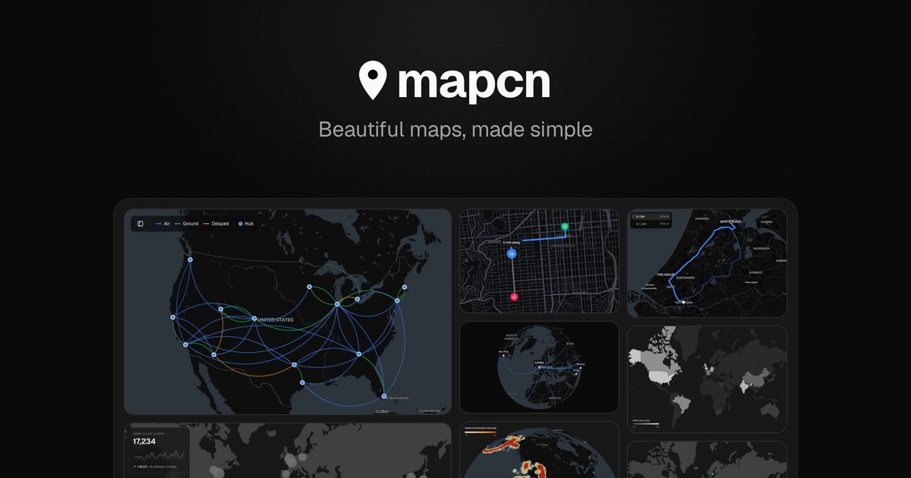

<h1 align="center">mapcn</h1>

<p align="center">
  Free & open-source, ready-to-use, customizable map components for React.<br/>
  Zero config. One command setup. Built on <a href="https://maplibre.org/">MapLibre GL</a>, styled with <a href="https://tailwindcss.com/">Tailwind</a>, works seamlessly with <a href="https://ui.shadcn.com/">shadcn/ui</a>.
</p>

<p align="center">
  <a href="https://mapcn.dev/docs">Get Started</a> ·
  <a href="https://mapcn.dev/docs/installation">Installation</a> ·
  <a href="https://mapcn.dev/docs/basic-map">Components</a>
</p>

<br />

<p align="center">
  <a href="https://vercel.com/oss">
    
  </a>
</p>

<p align="center">
  <picture>
    <source media="(prefers-color-scheme: light)" srcset="public/banner-light.png" />
    
  </picture>
</p>

## Features

- 🎨 **Theme-aware** — Automatically adapts to light/dark mode
- 🎯 **Zero config** — Works out of the box with sensible defaults
- 📦 **shadcn/ui compatible** — Uses the same patterns and styling conventions
- 🗺️ **MapLibre GL powered** — Full access to MapLibre's powerful mapping capabilities
- 🧩 **Composable** — Build complex map UIs with simple, declarative components
- 📍 **Markers & Popups** — Rich marker system with popups, tooltips, and labels
- 🛤️ **Routes** — Draw routes and paths on your maps
- 🎮 **Controls** — Zoom, compass, locate, and fullscreen controls

## Agent Skill

Teach your coding agent (Claude Code, Cursor, Codex, …) how to use mapcn:

```bash
npx skills add AnmolSaini16/mapcn
```

Then ask for a map, or ask where one would fit in your app. See [mapcn.dev/docs/skill](https://mapcn.dev/docs/skill).

## Basemap Terms of Service

mapcn uses [CARTO Basemaps](https://docs.carto.com/faqs/carto-basemaps) powered by OpenStreetMap data for its default styles and examples.

CARTO offers free tiers for commercial and non-commercial usage, subject to monthly tile request limits and attribution requirements.

- **Commercial use**: Free up to 1 million tile requests per month.
- **Non-commercial use**: Free up to 5 million tile requests per month.
- **Attribution**: CARTO and OpenStreetMap attribution must remain visible.
- **API keys**: CARTO requires API keys for raster basemaps and may extend this requirement to vector basemaps.

For production applications, review [CARTO's terms](https://carto.com/legal/basemap-terms/) and configure your own basemap provider or API key as needed.

mapcn is built on MapLibre and supports alternative MapLibre-compatible basemap providers.

## Sponsors

mapcn is free and open source, kept going by its sponsors. Want your logo here? See [mapcn.dev/sponsors](https://mapcn.dev/sponsors).

## Contributing

Contributions are welcome! Please feel free to submit a Pull Request.

1. Fork the repository
2. Create your feature branch (`git checkout -b feature/amazing-feature`)
3. Commit your changes (`git commit -m 'Add some amazing feature'`)
4. Push to the branch (`git push origin feature/amazing-feature`)
5. Open a Pull Request

## License

MIT License - see the [LICENSE](LICENSE) file for details.
